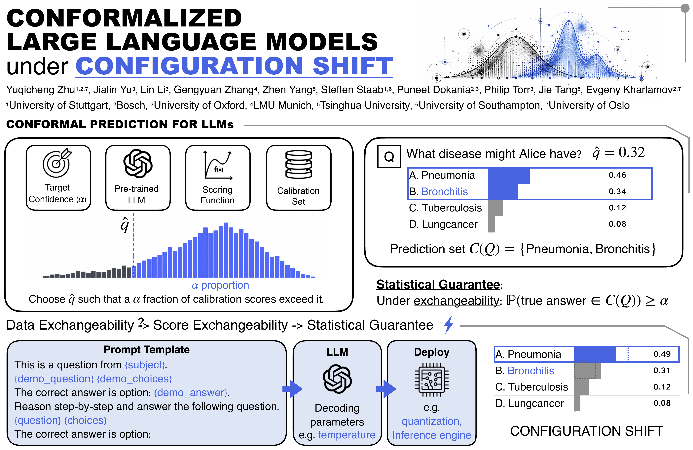

# CP4ConfigShift

**Conformal prediction for LLMs under configuration shift**: How do the coverage guarantee and prediction set size change when an LLM is calibrated under one inference configuration (e.g., prompt template, decoding temperature, model variant, or quantization) but deployed under another, while keeping the input data (i.e., questions) unchanged?

This is the code for *Conformalized Large Language Models under Configuration
Shifts* ([arXiv:2608.01460](https://arxiv.org/abs/2608.01460)). It is a small
library you can run on your own models and datasets; the paper's setup ships
as an example.



## How it works

```
examples (JSONL) + prompt template + configuration
        │  collect     run the LLM, cache raw outputs           (GPU / API)
        ▼
      run directory    option-label log-probs, or sampled answers
        │  score_run   nonconformity scores                     (CPU, seconds)
        ▼
      ScoreTable       a score and a correct/incorrect flag per candidate answer
        │  calibrate / evaluate / evaluate_shift                 (numpy)
        ▼
      thresholds, prediction sets, coverage and set size for every
      (calibration config, test config) pair
```

| Score | Needs | Task |
|---|---|---|
| `lac` (1 − p(y\|x)) | option-label logits (`mode="logits"`) | multiple-choice |
| `logit_margin` | option-label logits | multiple-choice |
| `self_consistency` (1 − frequency) | sampled answers (`mode="samples"`) | multiple-choice, open-ended |
| `lofreecp` (Su et al., 2024) | sampled answers + a sentence embedder | multiple-choice, open-ended |

## Install

```bash
uv venv && uv pip install -e ".[hf,embed]"      # transformers backend + LoFreeCP embedder
# extras: hf (transformers), gguf (llama.cpp, quantized models), api (OpenAI-compatible
# servers incl. vLLM; sampling only), embed (sentence-transformers), dev (pytest)
```

## Quickstart on your own data

**1. Examples** — one JSON object per line. Multiple-choice: `answer` is an
option index. Open-ended: `answer` is a list of accepted answers. `meta` is free-form.

```json
{"id": "q1", "question": "2 + 2 = ?", "choices": ["3", "4", "5", "6"], "answer": 1, "meta": {"subject": "arithmetic"}}
{"id": "q2", "question": "Capital of France?", "answer": ["Paris"]}
```

**2. Prompt templates** — a YAML file; see `examples/configs/templates_mcqa.yaml`
and the docstring of `cp4configshift/prompts.py` for the placeholders.

**3. Collect** one run per configuration (resumable; rerun to continue):

```python
import cp4configshift as cs

examples = cs.load_examples("data/my_mcqa.jsonl")
templates = cs.load_templates("my_templates.yaml")
for t in ["Baseline", "formal"]:
    cs.collect(examples, templates[t], cs.RunConfig(model="Qwen/Qwen3.5-0.8B", template=t),
               f"runs/qwen/{t}")
```

or sweep from the command line (models are loaded once per sweep):

```bash
cp4cs collect examples/configs/mcqa_prompt_logits.yaml --dataset data/my_mcqa.jsonl --output-dir runs/my
```

**4. Score and conformalize:**

```python
tables = {t: cs.score_run(f"runs/qwen/{t}", examples, "lac") for t in ["Baseline", "formal"]}

lam = cs.calibrate(tables["Baseline"], alpha=0.1)            # threshold from all examples
sets = tables["formal"].prediction_sets(lam)                  # deploy under another prompt

splits = cs.make_splits(len(examples), n_cal=500, n_test=500, n_trials=10, seed=0)
result = cs.evaluate_shift(tables, alpha=0.1, splits=splits)
print(result.summary())        # coverage, set size, undercoverage rate: i.i.d. vs shifted
rows = result.records()        # one row per (cal config, test config, trial), e.g. for pandas
```

For logits runs, the temperature is applied at scoring time, so one run covers
every temperature: `cs.score_run(run, examples, "lac", temperature=0.7)`. For
open-ended tasks pass `is_correct=` to customise answer matching, and
`answerable_only=True` to `evaluate_shift` to keep only questions the model can
answer under both configurations.

## Example: white-box results from the paper

As an example, you can reproduce the paper's results for the two white-box
scores (LAC and logit margin) on MMLU and MedMCQA: 9 open-weight models under
prompt-template (14 templates), decoding-temperature (5 values) and
quantization (4 GGUF variants of Qwen3.5-9B) shift.

**From the log-probabilities we collected** (CPU only, a few minutes):

```bash
python examples/paper/reproduce_whitebox.py --out results/
```

`examples/paper/{mmlu,medmcqa}_logprobs.npz` hold the option-label
log-probabilities from our runs, with example ids, answers and MMLU subjects.
The script follows the paper's protocol (10 calibration/test splits with seed
42; MMLU 30 + 30 questions per subject, MedMCQA 800 + 800) and writes two
tables with one row per (shift, dataset, model, score):

* `target_sweep.csv`: target coverage 1 − α ∈ {0.7, 0.8, 0.9, 0.95};
* `budget_sweep.csv`: calibration budget ρ ∈ {1/16, 1/8, 1/4, 1/2, 1} at 1 − α = 0.9.

Each row reports the undercoverage rate and the set-size inflation for i.i.d.
runs (same configuration) and shifted runs (different configurations).

**From scratch** (collect the log-probabilities yourself):

```bash
pip install datasets
python examples/prepare_datasets.py mmlu data/mmlu.jsonl
cp4cs collect examples/configs/mcqa_prompt_logits.yaml          # 9 models x 14 templates
cp4cs collect examples/configs/mcqa_quantization_logits.yaml    # needs [gguf] and the .gguf files
# MedMCQA: same with data/medmcqa.jsonl and --dataset data/medmcqa.jsonl --output-dir runs/medmcqa/...
python examples/paper/reproduce_whitebox.py --runs runs --out results/
```

Here the temperature shift is computed from the Baseline-prompt runs, while for
the paper we ran a separate forward pass per temperature; the two agree to
about 1e-6 in probability, which can flip a few ties at the threshold.
Re-collected log-probabilities can also differ slightly across hardware and
library versions.

## Layout

```
src/cp4configshift/
  data.py       Example, JSONL load/save
  prompts.py    templates (YAML) and rendering
  backends.py   HF transformers, llama.cpp (GGUF), OpenAI-compatible
  runs.py       RunConfig, collect, load_run, score_run
  scores.py     LAC, logit margin, self-consistency, LoFreeCP; parsing and matching
  table.py      ScoreTable
  conformal.py  split conformal prediction
  shift.py      splits and the calibration-config x test-config evaluation
  cli.py        cp4cs collect
examples/       dataset preparation, paper prompt templates and sweeps,
                paper/: collected white-box log-probs and the reproduction script
```

## Citation

```bibtex
@inproceedings{zhu2026configshift,
  title     = {Conformalized Large Language Models under Configuration Shift},
  author    = {Zhu, Yuqicheng and Yu, Jialin and Li, Lin and
               Zhang, Gengyuan and Yang, Zhen and Staab, Steffen and
               Dokania, Puneet and Torr, Philip and Tang, Jie and
               Kharlamov, Evgeny},
  booktitle = {Proceedings of the 2026 Conference on Empirical Methods
               in Natural Language Processing (EMNLP)},
  year      = {2026},
  publisher = {Association for Computational Linguistics},
  note      = {To appear},
  url       = {https://arxiv.org/abs/2608.01460}
}
```
